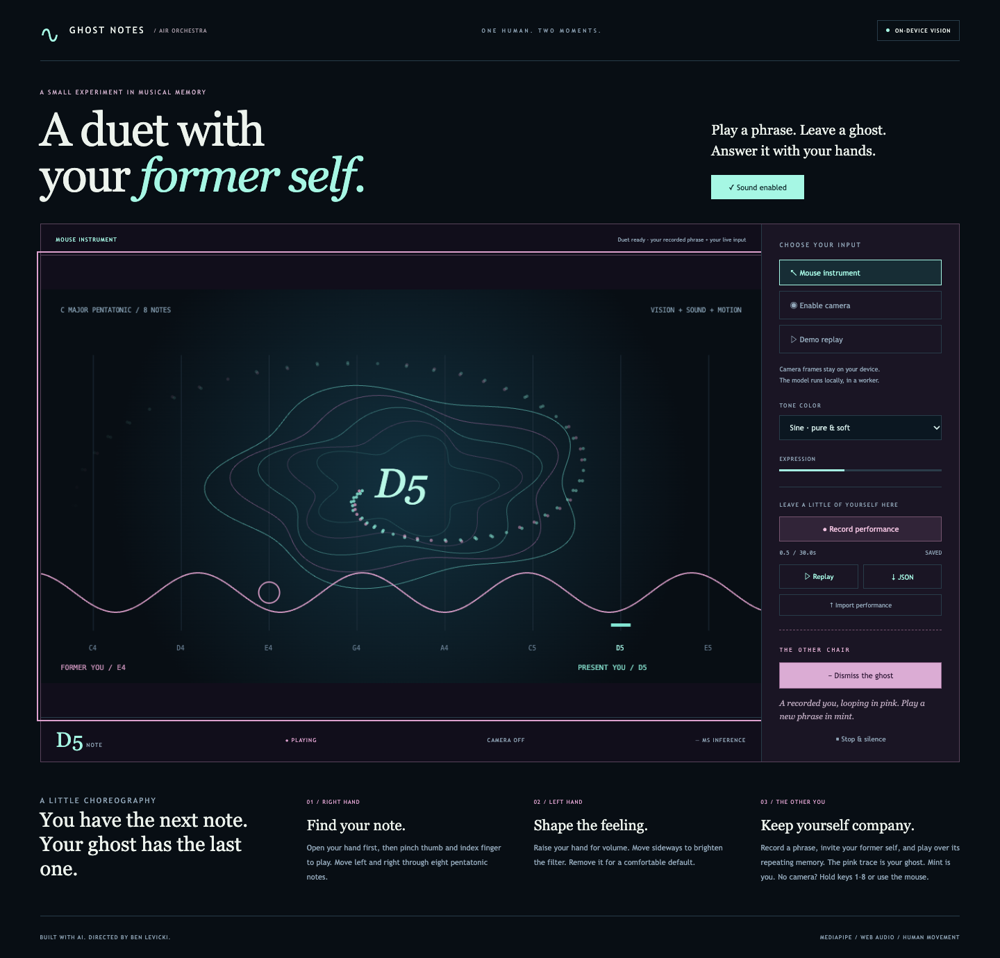
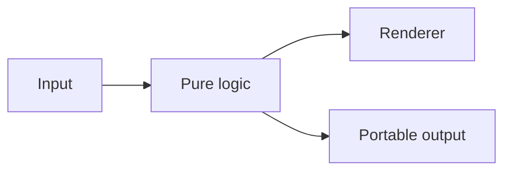

# Air Orchestra — Ghost Notes

Record a phrase, invite your former self, and play a duet across two moments.

[Open the live demo](https://bblevick.github.io/air-orchestra/) · [Watch the 50-second demonstration](docs/media/demo.mp4) · [Build specification](SPEC.md) · [Verification](docs/VERIFICATION.md)



## The other chair

After recording, invite your former self. A second monophonic synthesizer replays a snapshot of that phrase, with a 400 ms rest between loops, while your camera/mouse/keyboard controls the present voice. The ghost is pink, the present voice is mint. Dismiss the ghost or Stop to release it. Recording captures the present voice only; portable version 1 performances are single-voice controls, not a multitrack score. Camera frames are never recorded.

## What you can do

- A local MediaPipe hand model running in a dedicated classic worker, with one frame in flight and stale-frame dropping.
- Right-hand pinch gates eight C-major pentatonic notes; a left hand controls volume and filter. Sine and triangle presets.
- Mouse and keyboard alternatives, explicitly prerecorded demo mode, 30-second control recording, replay, and validated JSON transfer.

## Run locally

Use Node 24 LTS (`.nvmrc`) and npm. No API keys, accounts, or application backend are required.

```sh
npm ci
npm run dev
```

Open the local URL Vite prints. Downloads are needed for dependencies and initial asset preparation; application computation stays in the browser.

```sh
npm run typecheck
npm test
npx playwright install chromium webkit
npm run test:e2e
npm run build
npm run preview
```

## How it works

**MediaPipe · Web Audio · Canvas 2D · TypeScript**



Local camera frame → classic inference worker → landmarks → gesture controls → synthesizer + particles + recording.

## Runtime interfaces

Worker initialization receives `{type: "init", base}`. A ready response enables capture. Frame messages transfer an `ImageBitmap` with a monotonic timestamp; every bitmap is closed in the worker. Results contain landmarks, handedness, and measured inference duration. There is at most one frame in flight. Startup timeout is 30 seconds; stalled frames time out after 10 seconds. The application terminates its worker and stops camera tracks when leaving camera mode.

`GestureMapper.mapLandmarks(hands, timeMs)` produces a `ControlEvent`: relative timestamp, gate, note index (0–7), normalized volume and filter. Notes are C4, D4, E4, G4, A4, C5, D5, E5. Pinch distance is divided by palm width; gate thresholds are 0.28/0.45. After loss of tracking for 250 ms, the gate releases and an open hand is required before a new pinch. Left-hand absence uses a comfortable fixed volume and an open filter.

`Performance` version 1 stores `preset`, `durationMs`, and ordered `ControlEvent[]`. Imports are capped at 1 MB, 30 seconds, and 2,000 events. Negative, non-finite, out-of-range, or unordered values are rejected. Performance files contain controls, not webcam frames. There is no network upload.

## Input and sound

Click Start sound or an input action to enable Web Audio. In mouse mode, hold the primary pointer button on the stage and move it. Alternatively focus the stage and hold a key from 1–8. Escape or Stop releases the instrument and disables the camera. Tab hiding stops capture and releases sound. Preset selection is disabled during recording so replay retains the correct timbre.

`window.airOrchestra` exposes capture/diagnostic state without triggering camera access. The prerecorded demo is generated control data, not a saved camera session.

## Local assets

```sh
npm run assets:prepare
```

This bundles the classic worker and copies WASM from the exact locked MediaPipe package. The model is downloaded only if missing. The command runs automatically before development and production builds. `public/model-provenance.json` records package version, source and SHA-256 checksums. Runtime assets are served locally; no external CDN is used.

## Recreate the demonstration

```sh
# Requires FFmpeg on PATH and Playwright Chromium installed.
npm run demo:capture
```

This records a scripted, real browser walkthrough and creates `docs/media/demo.mp4`. It uses a temporary local port (4203) and requires approximately one minute. Raw captures stay in ignored `.artifacts/`. The soundtrack is resynthesized from captured present/ghost control events. The film shows recorded mouse playing, a ghost duet, and an explicitly prerecorded demo; it does not claim live webcam tracking.

## Limits

Two bounded monophonic voices with a pretrained model, not custom-trained gesture recognition. Real tracking depends on lighting, framing, and camera hardware. The demonstration video shows labeled demo replay and mouse input; it is not evidence of live webcam tracking. Real-hand Chrome behavior was separately confirmed by the user on October 24, 2026; no quantitative camera-latency benchmark is claimed.

[Measured local performance](docs/performance.json) reports a bounded headless-browser frame-scheduling sample, not a guarantee across devices.

## Deployment and license

GitHub Actions runs unit/browser checks, builds with the repository base path, and deploys to GitHub Pages. See [Publishing](docs/PUBLISHING.md).

Original code: [MIT](LICENSE). Bundled third-party code, models, and source data retain their own terms; see [notices](THIRD_PARTY_NOTICES.md).
